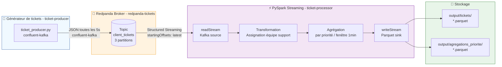

# Ticket Management POC — Redpanda + PySpark

> Projet 9 — OpenClassrooms Data Engineer  
> Pipeline ETL temps réel de gestion de tickets clients

---

## Présentation

Ce POC (Proof of Concept) implémente un pipeline de données en temps réel pour la gestion de tickets clients. Il simule l'ingestion, le traitement et l'export de tickets générés aléatoirement, en s'appuyant sur **Redpanda** comme broker de streaming et **PySpark** comme moteur de traitement distribué.

---

## Architecture du pipeline



---

## Structure du projet

```
ticket_management/
├── docker-compose.yml          # Orchestration des services
├── redpanda/
│   └── Dockerfile              # Image Redpanda v26.1.10
├── producer/
│   ├── Dockerfile              # Image producteur (Python + confluent-kafka)
│   └── ticket_producer.py      # Générateur de tickets aléatoires
└── processor/
    ├── Dockerfile              # Image processeur (Python + Java 17 + PySpark)
    └── ticket_processor.py     # Pipeline PySpark Structured Streaming
```

---

## Format des tickets

Chaque ticket généré contient les champs suivants :

| Champ | Type | Exemple |
|---|---|---|
| `ticket_id` | String | `TKT-00042` |
| `client_id` | String | `CLI-017` |
| `created_at` | ISO 8601 | `2026-07-03T14:32:11.123456` |
| `demande` | String | `Le système est inaccessible` |
| `type_demande` | String | `Incident technique` |
| `priorite` | String | `Haute` |

---

## Transformations PySpark

### Assignation automatique d'équipe support

| Type de demande | Équipe assignée |
|---|---|
| Incident technique | Équipe Infrastructure |
| Demande d'information | Équipe Support Niveau 1 |
| Facturation | Équipe Comptabilité |
| Accès et permissions | Équipe Sécurité |
| Performance | Équipe Performance |

### Agrégations temps réel

- **Tickets enrichis** : export Parquet avec équipe support assignée, en mode `append`
- **Tickets par priorité** : agrégation sur fenêtre glissante de 1 minute, export Parquet

---

## Prérequis

- Docker Desktop (ou Docker Engine + Docker Compose)
- 4 Go de RAM minimum disponibles pour Docker
- Ports libres : `19093`, `19645`

---

## Lancement

### 1. Cloner le dépôt

```bash
git clone https://github.com/AxelFB1992/projet9.git
cd ticket_management
```

### 2. Lancer le pipeline complet

```bash
docker compose up --build
```

Cette commande :
1. Démarre Redpanda et crée automatiquement le topic `client_tickets` (3 partitions)
2. Lance le générateur de tickets (1 ticket toutes les 5 secondes)
3. Lance le processeur PySpark (lecture, transformation, export Parquet)

### 3. Vérifier que les tickets arrivent dans Redpanda

```bash
docker exec -it redpanda-tickets rpk topic consume client_tickets --num 3
```

### 4. Vérifier les fichiers Parquet générés

```bash
docker exec -it ticket-processor ls /app/output/tickets/ | wc -l
```

### 5. Arrêter le pipeline

```bash
docker compose down
```

---

## Lire les résultats

Une fois le pipeline lancé, les données sont exportées en Parquet dans les volumes Docker. Pour les lire en local :

```python
import pandas as pd

# Tickets enrichis
df_tickets = pd.read_parquet("output/tickets/")
print(df_tickets.head(10))

# Agrégations par priorité
df_agg = pd.read_parquet("output/agregations_priorite/")
df_agg["window_start"] = pd.to_datetime(df_agg["window"].apply(lambda x: x["start"]))
df_agg["window_end"] = pd.to_datetime(df_agg["window"].apply(lambda x: x["end"]))
df_agg = df_agg.drop(columns=["window"]).sort_values(["window_start", "priorite"])
print(df_agg.to_string(index=False))
```

---

## Démonstration vidéo

> 📹 [https://www.loom.com/share/d7d9a3ac021a487b85d5dd667cc83504](#)  
> *(Remplacer par le lien YouTube/Loom après enregistrement)*

La vidéo présente :
- Le lancement du pipeline via `docker compose up`
- La vérification des tickets dans Redpanda Console
- Les transformations PySpark en temps réel
- La lecture des fichiers Parquet exportés

---

## Services Docker

| Service | Image | Rôle | Port exposé |
|---|---|---|---|
| `redpanda-tickets` | redpanda:v26.1.10 | Broker de streaming | 19093 |
| `redpanda-setup` | redpanda:v26.1.10 | Création du topic (one-shot) | — |
| `ticket-producer` | Python + confluent-kafka | Génération des tickets | — |
| `ticket-processor` | Python + Java 17 + PySpark | Traitement et export | — |

---

## Points de vigilance

- **`PYTHONUNBUFFERED=1`** est défini dans le docker-compose pour garantir la visibilité des logs Python en temps réel
- Les **checkpoints PySpark** sont stockés dans `/app/checkpoint/` à l'intérieur du container — ils sont réinitialisés à chaque `docker compose down`
- Le processor utilise **`startingOffsets: latest`** — lancer Spark avant le producteur pour ne manquer aucun message

---

*Projet réalisé dans le cadre de la formation Data Engineer — OpenClassrooms*
