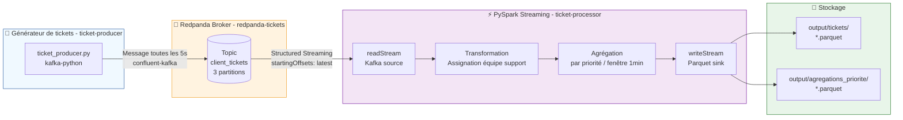

# Ticket Management POC — Redpanda + PySpark

> Projet 9 — OpenClassrooms Formation Data Engineer  
> Pipeline ETL temps réel de gestion de tickets clients

---

## Présentation

Ce POC (Proof of Concept) implémente un pipeline de données en temps réel pour la gestion de tickets clients. Il simule l'ingestion, le traitement et l'export de tickets générés aléatoirement, en s'appuyant sur **Redpanda** comme broker de streaming (boîte aux lettres en temps réél) et **PySpark** comme moteur de traitement distribué (permet de faire des calculs haute performance en divisant et distribuant les tâches).

---

## Architecture du pipeline (flux) de l'application



---

## Structure (répertoires) de l'application

```
ticket_management/
├── docker-compose.yml          # Orchestration des services
├── redpanda/
│   └── Dockerfile              # Image Redpanda v26.1.10
├── producer/
│   ├── Dockerfile              # Image producteur (Python + confluent-kafka)
│   └── ticket_producer.py      # Générateur de tickets aléatoires
└── processor/
    ├── Dockerfile              # Image processeur (Python + Java 17 + PySpark)
    └── ticket_processor.py     # Pipeline PySpark Structured Streaming
```

---

## Services Docker (conteneurs) de l'application

| Service | Image | Rôle | Port exposé |
|---|---|---|---|
| `redpanda-tickets` | redpanda:v26.1.10 | Broker de streaming | 19093 |
| `redpanda-setup` | redpanda:v26.1.10 | Création du topic (one-shot) | — |
| `redpanda-setup` | console:v3.7.4 | Affichage des topics et messages | — |
| `ticket-producer` | Python + confluent-kafka | Génération des tickets | — |
| `ticket-processor` | Python + Java 17 + PySpark | Traitement et export | — |

---

## Service 1 : Ticket - producer

### Description

Le service ticket-producer se charge de créer des ticket à intervalle de temps régulier (5sc) et à les envoyer sur un serveur Kafka (compatible au protocole kafka). En l'occurrence ici, le serveur kafka n'est autre que notre conteneur RedPanda-tickets à l'adresse localhost sur le port 9092.

### Format des tickets

Chaque ticket généré contient les champs suivants :

| Champ | Type | Exemple |
|---|---|---|
| `ticket_id` | String | `TKT-00042` |
| `client_id` | String | `CLI-017` |
| `created_at` | Datetime | `2026-07-03T14:32:11.123456` |
| `demande` | String | `Le système est inaccessible` |
| `type_demande` | String | `Incident technique` |
| `priorite` | String | `Haute` |

---

## Service 2 : RedPanda-tickets

Ce service est le broker de streaming RedPanda qui n'est construit qu'à partir d'une image RedPanda pré-existante (voir DockerFile du répertoire RedPanda). Il expose (rend public) cependant les ports 9092, 9644, 8081, 8082 pur plusieurs communiquants (producer) puisse discuter avec lui. Attention ces ports ne spécifient pas les ports publics mais au contraire les ports internes par lesquels les flux de communication vont arriver. Les ports publics d'accès sont ceux qui seront donnés sur le docker compose et mappés avec des ports internes : ici le port 19093 sera mappé avec le 9092 et le port 19645 era mappé avec le port 9644. On remarquera qu'il ne prend pas le port 8080 qui est reservé au service RedPanda-console permettant de visualiser les topics et messages via un navigateur web.

---

## Service 3 : Ticket - processor

### Description

Ce service consomme les messages du topic client_tickets depuis Redpanda, les enrichit et les agrège en temps réel via PySpark Structured Streaming, puis exporte les résultats en Parquet.

Ce service réalisation 7 groupes d'actions correspondant à des lectures et transformations pySpark :
 - 1. Création de la session spark : permet d'initialiser le contexte d'exécution Spark et de le configurer. Autrement dit, cette partie permet de créer un flux de lecture vierge et de le configurer grâce à différentes options (packages de base, nombre de partitions, mémoire du driver, mémoire des executors).
 - 2. Création du schéma de ticket : permettra de decomposer chacun des messages obtenus et de retrouver sa structure intiale ainsi que les champs avec lesquels il a été construit.
 - 3. Initialisation du flux via la session Spark : on se charge désormais de viser un flux en particulier -> Il s'agit en l'occurence de celui qui transite sur notre broker RedPanda (redpanda-tickets). Celui-ci sera renseigné dans les options du lecteur par le nom de l'option 'kafka.bootstrap.servers' et le champ bootstrap_servers. On renseignera également le topic auquel on veut s'abonner ('subscribe') en tant que consommateur ainsi que d'autres options (startingOffsets, failOnDataLoss).
 - 4. Déserialisation des messages : Dans le flux écouté (partie ci-dessus), on va spécifier ce que l'on veut extraire à savoir la valeur des balises json ('value') : cela representera un message. On lui appliquera le schéma précedemment crée pour séparer les différents champ de ce messages. Tous les messages seront stockés temporairement dans la variable tickets avant de passer aux traitements suivants.
 - 5. Assignation d'une équipe support en temps réel : Il s'agit juste d'un léger traitement qui permettra d'enrichir les données du ticket en lui affectant d'office une équipe support en fonction des conditions spécifiées dans cette partie.
 - 6. Agrégations : Traitement plus complexes qui nécessite typiquement la puissance de spark lorsqu'ils sont réalisés sur une grande quantité de données qui arrive en temps réel. Ici nous réalisons 3 agrégations (groupy by) sont réalisés (1 seul sera réellement écrit sur fichier et stocké en mémoire) en fonction de 3 champs à savoir : 
         - Agrégation par priorité - colonne "priorité" : "Basse", "Moyenne", "Haute", "Critique".
         - Agrégation par type - colonne "type_demande" : "Incident technique", "Demande d'information", "Facturation", "Accès et permissions", "Performance".
         - Agrégation par équipe - colonne "equipe_support" : "Équipe Infrastructure", "Équipe Support Niveau 1", "Équipe Comptabilité", "Équipe Sécurité", "Équipe Performance".
 - 7. Ecriture des tickets et des résultats. Ici, seulement 1 seul résultat des 3 agrégations sera conservé et stocké dans un fichier : celui par priorité, les autres ne seront pas conservés par souci de performance sur machine locale (4 queries en parallèle étaient trop lourdes). Par ailleurs on stockera les tickets enrichis par l'équipe de traitement et on les affichera également sur la console. Ce qui fait 3 écritures au total :
         - Ecriture des tickets enrichis sur la console (toutes les 5 secondes - en même temps qu'ils arrivent/temps réel).
         - Ecriture des tickets enrichis dans un fichier parquet (toutes les 10 secondes - environ 2 tickets par batch/fichier selon le débit).
         - Ecriture du résultat de l'agrégation par proritité (toutes les 30 secondes - environ 6 tickets par batch/fichier selon le débit).

### Transformations PySpark

#### Assignation automatique d'équipe support

- **Tickets enrichis** : export Parquet avec équipe support assignée, en mode `append`

| Type de demande | Équipe assignée |
|---|---|
| Incident technique | Équipe Infrastructure |
| Demande d'information | Équipe Support Niveau 1 |
| Facturation | Équipe Comptabilité |
| Accès et permissions | Équipe Sécurité |
| Performance | Équipe Performance |

#### Agrégations temps réel

- **Tickets par priorité** : agrégation sur fenêtre glissante de 1 minute, export Parquet.
- **Tickets par type de demande** : agrégation sur fenêtre glissante de 1 minute, export Parquet.
- **Tickets par équipe support (sur tickets enrichis impérativement)** : agrégation sur fenêtre glissante de 1 minute, export Parquet.

---

## Service 4 : redpanda-tickets-console

A l'instar de redpanda-tickets, ce service se base sur une image déjà existante (console:v3.7.4) et le docker compose se charge de configurer quelques points particuliers notamment le port d'accès (par lequel on va accéder publiquement à son service) : ici il se trouve que c'est le port 8080 (classique pour un service web). De même on aura aussi les dépendances et l'environnement c'est à dire le broker pour lequel la console va afficher les topics et messages : ici c'est naturellement notre service redpanda-tickets sur son port internet 9092.

---

## Service 5 : redpanda-setup

De la même manière que précedemment, ce service se base sur une image déjà existante et a pour utilité unique de créer un topic sur le service redpanda-tickets:9092. Dès lors, il disparaitra et ne sera plus jamais executé. 

---

## Execution de l'application (sur machine local)

### Prérequis (machine local)

- Docker Desktop (ou Docker Engine + Docker Compose)
- 4 Go de RAM minimum disponibles pour Docker
- Ports libres : `19093`, `19645`

---

### Lancement et Arrêt (en local)

#### 1. Cloner le dépôt

```bash
git clone https://github.com/AxelFB1992/projet9.git
cd ticket_management
```

#### 2. Lancer le pipeline complet

```bash
docker compose up --build
```

Cette commande :
1. Démarre le broker de streaming RedPanda - RedPanda-tickets  et crée automatiquement le topic `client_tickets` (3 partitions)
2. Lance le générateur de tickets - ticket-producer (1 ticket toutes les 5 secondes)
3. 3. Lance le processeur PySpark - tickets-processor (lecture, transformation, export Parquet)

#### 3. Arrêter le pipeline

```bash
docker compose down
```

---

### Commandes utiles (en execution)

#### Se connecter aux différents conteneurs via le terminal (bash)

Ces commandes permettent de se connecter aux différents conteneurs comme si il s'agissait d'ordinateurs séparés. A l'intérieur de chacun d'eux, les commandes sont dès lors plus courtes.

##### 1. Redpanda broker

```bash
docker exec -it redpanda-tickets bash
```

##### 2. Producer

```bash
docker exec -it ticket-producer bash
```

##### 3. Processor

```bash
docker exec -it ticket-processor bash
```

#### Vérifier les informations envoyés et générés (bash)

##### 1. Vérifier que les tickets arrivent dans Redpanda

```bash
docker exec -it redpanda-tickets rpk topic consume client_tickets --num 3
```

#### 2. Vérifier les fichiers Parquet générés

```bash
docker exec -it ticket-processor ls /app/output/tickets/ | wc -l
```

#### Afficher les logs en temps réel (-f) des différents conteneurs (bash)

##### 1. Redpanda broker

```bash
docker logs -f redpanda-tickets
```

##### 2. Producer

```bash
docker logs -f ticket-producer
```

##### 3. Processor

```bash
docker logs -f ticket-processor
```

##### 4. Redpanda console 

La commande ci-dessous n'est pas très utile car les informations sont visibles via un navigateur à l'adresse : **http://localhost:8080**

```bash
docker logs -f redpanda-tickets-console
```

---

### Lire les résultats (via script python)

Une fois le pipeline lancé, les données sont exportées en Parquet dans les volumes Docker. Pour les lire en local :

```python
import pandas as pd

# Tickets enrichis
df_tickets = pd.read_parquet("output/tickets/")
print(df_tickets.head(10))

# Agrégations par priorité
df_agg = pd.read_parquet("output/agregations_priorite/")
df_agg["window_start"] = pd.to_datetime(df_agg["window"].apply(lambda x: x["start"]))
df_agg["window_end"] = pd.to_datetime(df_agg["window"].apply(lambda x: x["end"]))
df_agg = df_agg.drop(columns=["window"]).sort_values(["window_start", "priorite"])
print(df_agg.to_string(index=False))
```

---

## Démonstration vidéo

> 📹 [https://www.loom.com/share/d7d9a3ac021a487b85d5dd667cc83504](#)  
> *(Remplacer par le lien YouTube/Loom après enregistrement)*

La vidéo présente :
- L'explication du contexte de l'application et de son utilité.
- La présentation de l'architecture de l'application via ses répertoires.
- L'execution du pipeline via `docker compose up et l'analyse des logs.
- La vérification des tickets dans Redpanda Console.
- Les transformations PySpark en temps réel.

---

## Points de vigilance

- **`PYTHONUNBUFFERED=1`** est défini dans le docker-compose pour garantir la visibilité des logs Python en temps réel.
- Les **checkpoints PySpark** sont stockés dans `/app/checkpoint/` à l'intérieur du container — ils sont réinitialisés à chaque `docker compose down`.
- Le producer démarre quelques secondes avant que Spark soit pleinement initialisé — les premiers messages envoyés pendant ce délai ne seront pas traités, ce qui est un comportement normal en mode startingOffsets: latest. Pour traiter tous les messages depuis le début du topic, utiliser startingOffsets: earliest.

---

*Projet réalisé dans le cadre de la formation Data Engineer — OpenClassrooms*
